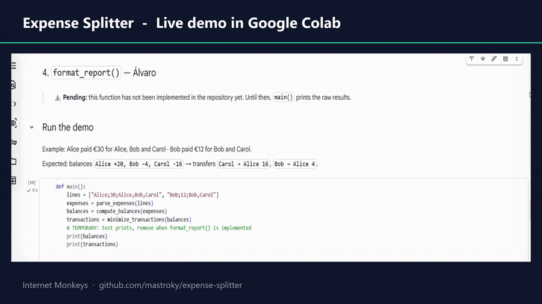

# Expense Splitter

A simple Python tool that calculates the net balance of each person in a group and the minimum number of payments needed to settle shared expenses.

## Demo

[](media/demo.mp4)

▶ [Watch the full demo video](media/demo.mp4) · [Open the notebook in Google Colab](https://colab.research.google.com/drive/1ur1btqPeHpwfWmUrYMn0qxqK9QAA4kyM)

## How it works

- `parse_expenses()`: reads each expense from text.
- `compute_balances()`: calculates how much each person is owed (+) or owes (-).
- `minimize_transactions()`: finds the fewest payments to settle all debts.
- `format_report()`: prints the result in a readable way.

## Input format

One expense per line:

```
payer;amount;participant1,participant2,...
```

Example: `Alice;30;Alice,Bob,Carol` means Alice paid 30 shared equally by Alice, Bob and Carol.

## Usage

Requires Python 3.9 or later. No external libraries needed.

```
python expense_splitter.py
```

## Example

Input:

```
Alice;30;Alice,Bob,Carol
Bob;12;Bob,Carol
```

Balances: Alice +20, Bob -4, Carol -16

Output:

```
Carol pays Alice: 16.00 EUR
Bob pays Alice: 4.00 EUR
```

## Team: Internet Monkeys

| Member | Function |
|---|---|
| Matteo Mastrosanti ([mastroky](https://github.com/mastroky)) | `parse_expenses()` |
| Rubén Cerro Díaz ([rubencerroo](https://github.com/rubencerroo)) | `compute_balances()` |
| Raúl Cortés Caballero ([Nhorac](https://github.com/Nhorac)) | `minimize_transactions()` |
| Álvaro Alemán Cabello ([usernamealphanumeric25](https://github.com/usernamealphanumeric25)) | `format_report()` |

## License

This project is licensed under the MIT License.
